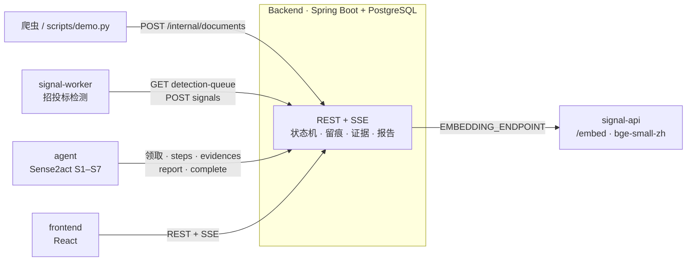

# Sense2Act · SignalX

招投标商机发现与情报调查平台：**采集公告 → 发现信号 → Agent 深度调查 → 带证据链的报告 → 反馈迭代**。

市面产品回答"发生了什么"，Sense2Act 回答"这件事查实了没有、哪些还没查清、依据是什么"。

## 架构



后端是唯一的数据与流程中枢：外部服务只调后端、互不直连；所有不变量（状态机、轮次/预算上限、证据引用）在后端强制。

| 环节 | 谁做 | 怎么交接 |
| --- | --- | --- |
| 采集 | 爬虫（演示用 `scripts/demo.py` 代替） | `POST /internal/documents`：去重、快照、机构归一、基线 |
| 信号 | `signal-service` 的 `python -m bridge` | 拉 `detection-queue`（文档 + 规则 + 关注画像），取同单位历史，跑检测，`POST /internal/signals`；评分达策略阈值后端自动立项 |
| 调查 | `agent` 的 `python -m sense2act worker` | 领取 `created` 调查 → `start` → `context` 装配信封 → S1–S7 循环；台账每条决策实时回写为 steps / questions / evidences |
| 报告 | agent 提交，后端校验 | 每条结论必须引用已登记证据；fact / inference / speculation 分开；`complete` 后信号 confirmed |
| 呈现 | `frontend` | REST 读数据，SSE 实时看调查时间线与全局通知；反馈写回 |
| 语义检索 | `signal-service` 的 `/embed` | 后端 `EMBEDDING_ENDPOINT` 线约，与检测共用同一个 512 维模型 |

字段级映射见 [docs/integration.md](docs/integration.md)；后端接口契约见 [Backend/docs/api-design.md](Backend/docs/api-design.md)。

## 目录

```
Sense2Act/
├── Backend/          Spring Boot 后端：数据、流程、契约（文档在 Backend/docs）
├── signal-service/   信号服务：招投标/新闻检测算法 + bridge/（后端检测 worker）+ /embed
├── agent/            Sense2act 调查 Agent：S1–S7 循环 + sense2act/bridge/（后端调查 worker）
├── frontend/         SignalX 工作台：React + Vite，直连后端
├── scripts/demo.py   全链路演示
├── docs/             跨组件文档
├── docker-compose.yml / .env.example
└── _archive/         重构前的原始压缩包（不入库）
```

## 快速开始（全栈容器）

前置：Docker Desktop。

```bash
cp .env.example .env              # 默认值即可跑；国内网络把 HF_ENDPOINT 改成 https://hf-mirror.com
docker compose up -d --build      # 首次构建会下载 CPU 版 torch 与语义模型
python scripts/demo.py            # 推 5 条公告，观察 检测 → 立项 → 调查 → 报告
```

打开 http://127.0.0.1:5173 ，用 `analyst@sense2act.local / analyst123` 登录（另有 `admin / admin123`、`viewer / viewer123`）。
demo 运行时打开对应调查页，可实时看到 Agent 的每一轮查证。

Agent 默认 `AGENT_MODE=replay`：用 `agent/examples/tender_medical_ai` 的录制响应调查，零 key、结果可复现，写回后端的是真实的调查、证据和报告。
接真实模型：`.env` 里设 `AGENT_MODE=live` 和 `DEEPSEEK_API_KEY`，再 `docker compose up -d agent`。

## 本地开发

各组件可单独在 IDE 里跑，其余用容器补齐：

```bash
docker compose up -d postgres signal-api      # 数据库 + 向量端点
# Backend：IDEA 运行 BackendApplication（local profile，连 localhost:5432）
#   环境变量 INTERNAL_API_KEY=local-dev-internal-key，EMBEDDING_ENDPOINT=http://127.0.0.1:8001/embed（可选）
cd frontend && npm install && npm run dev     # http://127.0.0.1:5173，/api 自动代理到 8080
cd agent && INTERNAL_API_KEY=local-dev-internal-key python -m sense2act worker --mode replay
cd signal-service && INTERNAL_API_KEY=local-dev-internal-key python -m bridge   # 需本地语义模型，见其 README
```

## 测试

| 组件 | 命令 |
| --- | --- |
| Backend | `cd Backend && mvn -B verify`（Testcontainers，需 Docker） |
| signal-service | `cd signal-service && python -m pytest -q`（Windows 加 `PYTHONUTF8=1`） |
| agent | `cd agent && pip install -r requirements.txt && python -m unittest discover -s tests -p "test_*.py"`（Windows 加 `PYTHONUTF8=1`） |
| frontend | `cd frontend && npm run build`（含类型检查） |

两个 bridge 各有契约测试（`signal-service/tests/test_bridge.py`、`agent/tests/test_bridge.py`），用假后端校验与后端一致的不变量。

## 当前边界

- **新闻信号**：`signal-service/signals/news` 的检测保留完整，但后端信号模型以文档为锚、尚无新闻信号入口，新闻暂不进入平台链路（只检测不立项）。
- **采集**：仓库内没有常驻爬虫服务；演示数据经 `scripts/demo.py` 以爬虫身份推送，`Backend/scripts/seed_*.py` 仍可用。
- **前端 Mock 已移除**：页面只读真实后端；演示改用全栈容器 + demo 脚本。原 Mock 版本在 `_archive/前端.rar`。
