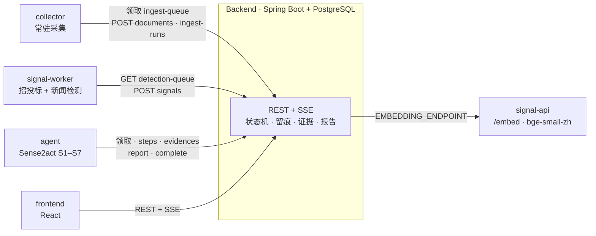

# Sense2Act · SignalX

招投标商机发现与情报调查平台：**采集公告与新闻 → 发现信号 → Agent 深度调查 → 带证据链的报告 → 反馈迭代**。

市面产品回答"发生了什么"，Sense2Act 回答"这件事查实了没有、哪些还没查清、依据是什么"。

## 架构



后端是唯一的数据与流程中枢：外部服务只调后端、互不直连；所有不变量（状态机、轮次/预算上限、证据引用）在后端强制。

| 环节 | 谁做 | 怎么交接 |
| --- | --- | --- |
| 采集 | `collector` 的 `python -m collector` | 领取到期信息源（前端「信息源管理」配置），复用 agent 的爬虫适配器抓取，`POST /internal/documents`（去重、快照、机构归一、基线），`POST /internal/ingest-runs` 回报健康度 |
| 信号 | `signal-service` 的 `python -m bridge` | 拉 `detection-queue`。招投标公告：取同单位历史跑检测；新闻：从快照读原文时间，按主体与事件归组、多来源共振评分。命中 `POST /internal/signals`，评分达策略阈值后端自动立项 |
| 调查 | `agent` 的 `python -m sense2act worker` | 领取 `created` 调查 → `start` → `context` 装配信封（招投标 → tender，新闻 → rumor）→ S1–S7 循环；台账每条决策实时回写为 steps / questions / evidences |
| 报告 | agent 提交，后端校验 | 每条结论必须引用已登记证据；fact / inference / speculation 分开；`complete` 后信号 confirmed |
| 呈现 | `frontend` | REST 读数据，SSE 实时看调查时间线与全局通知；反馈写回 |
| 语义检索 | `signal-service` 的 `/embed` | 后端 `EMBEDDING_ENDPOINT` 线约，与检测共用同一个 512 维模型 |

字段级映射见 [docs/integration.md](docs/integration.md)；后端接口契约见 [Backend/docs/api-design.md](Backend/docs/api-design.md)。

## 目录

```
Sense2Act/
├── Backend/          Spring Boot 后端：数据、流程、契约（文档在 Backend/docs）
├── collector/        常驻采集：领取到期信息源 → 抓取 → 推文档（适配器复用 agent/sense2act/crawler）
├── signal-service/   信号服务：招投标/新闻检测算法 + bridge/（后端检测 worker）+ /embed
├── agent/            Sense2act 调查 Agent：S1–S7 循环 + sense2act/bridge/（后端调查 worker）
├── frontend/         SignalX 工作台：React + Vite，直连后端
├── scripts/demo.py   全链路演示（招投标 + 新闻）
├── docs/             跨组件文档
├── deploy/           服务器部署：生产变量模板、宿主机 nginx 示例、步骤说明
├── .github/workflows/ci.yml   按目录只跑改动组件的测试
├── docker-compose.yml / docker-compose.prod.yml / .env.example
└── _archive/         重构前的原始压缩包（不入库）
```

## 快速开始（全栈容器）

前置：Docker Desktop。

```bash
cp .env.example .env              # 默认值即可跑；国内网络把 HF_ENDPOINT 改成 https://hf-mirror.com
docker compose up -d --build      # 首次构建会下载 CPU 版 torch 与语义模型
python scripts/demo.py            # 招投标与新闻两条链路：入库 → 检测 → 立项 → 调查 → 报告
```

打开 http://127.0.0.1:5173 ，用 `analyst@sense2act.local / analyst123` 登录（另有 `admin / admin123`、`viewer / viewer123`）。
demo 运行时打开对应调查页，可实时看到 Agent 的每一轮查证。`--scenario tender|news` 只跑其中一条。

两条演示链路：

- **招投标**：「XX市第一人民医院」4 条历史公告 + 1 条 480 万 AI 辅助诊断招标 → 金额与新颖性异常信号 → 调查。
- **新闻**：4 家媒体对"科大讯飞等联合发布智能化工大模型 3.0Pro"的真实报道 → 竞品动态信号（4 个独立来源共振）→ 传闻核实调查。样本日期为 2026-08-31 / 09-03，平台新闻配置回看 180 天，2027-02 底前有效。

Agent 默认 `AGENT_MODE=replay`：招投标信号回放 `agent/examples/tender_medical_ai`，新闻信号回放 `agent/examples/ai_model_release`，零 key、结果可复现，写回后端的是真实的调查、证据和报告。
接真实模型：`.env` 里设 `AGENT_MODE=live` 和 `DEEPSEEK_API_KEY`，再 `docker compose up -d agent`。

真实数据：在前端「信息源管理」新增信息源（适配器如 `ccgp` 中国政府采购网，采集配置写关键词、品目等，见 [collector/README.md](collector/README.md)），采集服务到点自动抓取入库。

## 服务器部署

```bash
cp deploy/prod.env.example .env       # 填强随机值;必填项留空会拒绝启动
docker compose -f docker-compose.yml -f docker-compose.prod.yml up -d --build
```

宿主机 nginx 终止 TLS 后反代到前端容器（`deploy/nginx.conf.example`）。完整步骤、更新与备份见 [deploy/README.md](deploy/README.md)。

## 本地开发

各组件可单独在 IDE 里跑，其余用容器补齐：

```bash
docker compose up -d postgres signal-api      # 数据库 + 向量端点
# Backend：IDEA 运行 BackendApplication（local profile，连 localhost:5432）
#   环境变量 INTERNAL_API_KEY=local-dev-internal-key，EMBEDDING_ENDPOINT=http://127.0.0.1:8001/embed（可选）
cd frontend && npm install && npm run dev     # http://127.0.0.1:5173，/api 自动代理到 8080
cd agent && INTERNAL_API_KEY=local-dev-internal-key python -m sense2act worker --mode replay
cd signal-service && INTERNAL_API_KEY=local-dev-internal-key python -m bridge   # 需本地语义模型，见其 README
cd collector && PYTHONPATH=../agent INTERNAL_API_KEY=local-dev-internal-key python -m collector
```

## 测试

| 组件 | 命令 |
| --- | --- |
| Backend | `cd Backend && mvn -B verify`（Testcontainers，需 Docker） |
| signal-service | `cd signal-service && python -m pytest -q`（Windows 加 `PYTHONUTF8=1`） |
| agent | `cd agent && pip install -r requirements.txt && python -m unittest discover -s tests -p "test_*.py"`（Windows 加 `PYTHONUTF8=1`） |
| collector | `cd collector && pip install -r requirements.txt && PYTHONPATH=../agent python -m unittest discover -s tests -p "test_*.py"` |
| frontend | `cd frontend && npm run build`（含类型检查） |

CI（`.github/workflows/ci.yml`）在 push / PR 时按改动目录只跑相关组件，命令与上表一致；后端改动的 PR 另跑 oasdiff 契约破坏性检查。
三个 worker 各有契约测试（`collector/tests`、`signal-service/tests/test_bridge*.py`、`agent/tests/test_bridge.py`），用假后端校验与后端一致的不变量。

## 当前边界

- **真实模型**：默认 replay 只回放两个录制案例；live 模式需要 DeepSeek key，真实公告上的调查质量、token 消耗与耗时还没系统测过。
- **采集范围**：已接中国政府采购网、天津政采、乙方宝（仅列表级）和头条/南周/央视/搜狗微信（新闻检索）。不做验证码对抗、签名逆向、代理池；被拦截如实回报，源健康度随之降级。
- **新闻监测主体**：由 `signal-service/signals/news/platform.json` 配置（医疗 AI 竞品与行业主体），换监测对象改这个文件，或用 `SIGNAL_NEWS_CONFIG` 指向别的配置。
- **前端 Mock 已移除**：页面只读真实后端。原 Mock 版本在 `_archive/前端.rar`。
